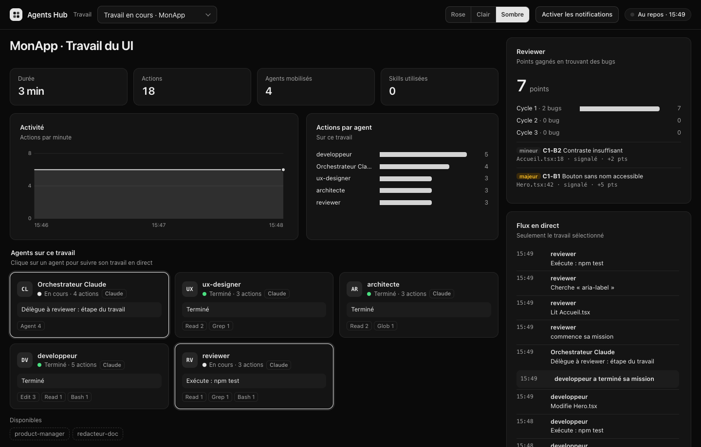

# Agents Hub

*[Version française](README.md)*

A live dashboard that shows what your Claude Code and Codex agents are doing.

## Why

I couldn't see my agents while they were working, so I built Agents Hub: a dashboard that shows, live, what my Claude Code and Codex agents are doing. It's my first source-available project. I'm sharing it so anyone can use it, adapt it to their needs and fix the issues they run into.



## What it does

- Shows your agents live: who is working, with which tool, on what.
- Works with **Claude Code** and **Codex**, the same way.
- **One window per task**, with its title at the top ("Project · Title"). Never two windows for the same task.
- The window opens **only when you ask for it** (see Usage). The rest of the time, activity is recorded in the background, so everything is there when you open it.
- A scoreboard for the reviewer: the bugs found in the task, over 3 review cycles.
- Three themes: Dark (default), Pink and Light.

The interface is in French.

## Install

Requirements: macOS or Linux, Python 3.8+, Claude Code and/or Codex. Chrome is optional (otherwise your usual browser is used).

```sh
git clone https://github.com/marissa274/agents-hub
cd agents-hub
./install.sh
```

The installer never replaces what you already have and backs up your settings before changing them (in `backups/`). Then:

- **Claude Code**: restart it.
- **Codex** (set up automatically if installed): run `codex`, type `/hooks`, then approve the Agents Hub hooks. Codex only runs them after you approve.

## Usage

| | Claude Code | Codex |
|---|---|---|
| Open the window for the current task | `/hub` | `$hub` |
| Or simply say | "open the hub" | "open the hub" |

You can also run `bin/hub` in a terminal. Saying "use my agents" puts the team to work **without** opening a window.

The first time, Codex asks for permission to start the hub (it starts a small local server and opens your browser, which is outside its sandbox). Choose "always allow" so you don't have to do it again.

## Agents

Agents Hub shows **all** your agents: your project's and your computer's. It also ships with 6 base agents for when you don't have your own (their instructions are in French):

- `product-manager`: turns a need into user stories.
- `architecte`: plans the technical approach before coding.
- `ux-designer`: user flows, mockups and accessibility.
- `developpeur`: writes the code and the fixes, with tests.
- `redacteur-doc`: documentation and release notes.
- `reviewer`: hunts for bugs and scores points.

### Add your own agents

An agent is just a text file:

| | Claude Code | Codex |
|---|---|---|
| For one project | `.claude/agents/my-agent.md` | `.codex/agents/my-agent.toml` |
| For all your projects | `~/.claude/agents/my-agent.md` | `~/.codex/agents/my-agent.toml` |

Claude Code example:

```markdown
---
name: tester
description: Writes and runs the project's tests.
---
Write clear tests for each feature, then run them.
```

Codex example:

```toml
name = "tester"
description = "Writes and runs the project's tests."
developer_instructions = """
Write clear tests for each feature, then run them.
"""
```

Restart Claude Code or Codex so it sees the new agent.

## Update

```sh
cd agents-hub
git pull
./install.sh
```

If the open hub doesn't show the changes, stop its server (`pkill -f agents-hub/bin/server.py`), then open it again with `/hub`.

## Privacy

Everything stays on your machine: the hub only listens on `127.0.0.1` and sends nothing over the internet. The `logs/` folder contains your messages and your agents' activity: it is ignored by git, never publish it.

## Uninstall

```sh
./uninstall.sh
```

Removes the installed hooks, agents and skill (a file you modified is kept). Your logs and the project folder are not touched.

## Options and special cases

- `./install.sh --no-codex`: installs nothing for Codex.
- `CODEX_HOME` and `CLAUDE_CONFIG_DIR`: if Codex or Claude Code are not in their usual folder.
- You already have your own `hub` skill: it is kept. Rename it, then run `./install.sh` again to install the Agents Hub one.
- You move the `agents-hub` folder: run `./install.sh` again (and `/hooks` in Codex).
- Without approved hooks, Codex is still followed by reading its session files, with a little less detail.
- Windows is not supported yet.

## Contributing

Contributions are welcome. To add another tool (Cursor, Gemini…), copy `bin/adapters/codex.py`, adapt it, then add it to `bin/adapters/__init__.py`. Run the tests with `python3 -m unittest discover tests`.

## Our philosophy

Agents Hub is a community project: free, with its source code available.

Our goal is simple: make development tools accessible to as many people as possible, encourage learning and foster collaboration.

Everyone is welcome to use, study, improve and share Agents Hub, within the terms of its noncommercial license.

Agents Hub is not meant to become a commercial product. Its development relies on sharing knowledge, helping each other and contributions from the community.

Commercial use is not permitted under the current license.

## License

[PolyForm Noncommercial 1.0.0](LICENSE): you may use, copy, modify and share Agents Hub **for free, for noncommercial purposes** (personal use, study, research, nonprofits…).

**Selling Agents Hub, or using it in a paid product or service, requires my permission.** For a commercial license, contact me on [LinkedIn](https://www.linkedin.com/in/marissa-belle-bindeki-b32090333/).

Made by [Marissabelle Bindeki](https://www.linkedin.com/in/marissa-belle-bindeki-b32090333/)
