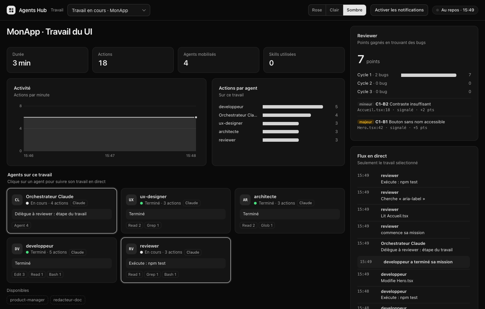

# Agents Hub

*A live dashboard that shows what your Claude Code and Codex agents are doing. — [English version](README.en.md)*

Un tableau de bord qui montre en direct ce que font tes agents Claude Code et Codex.

## Pourquoi

Je n'arrivais pas à voir mes agents travailler, alors j'ai créé Agents Hub : un tableau de bord qui montre en direct ce que font mes agents Claude Code et Codex. C'est mon premier projet au code ouvert : je le partage pour que tout le monde puisse l'utiliser, l'adapter à ses besoins et régler les problèmes qu'il rencontre.



## Ce qu'il fait

- Montre tes agents en direct : qui travaille, avec quel outil, sur quoi.
- Marche avec **Claude Code** et **Codex**, de la même façon.
- **Une fenêtre par tâche**, avec son titre en haut (« Projet · Titre »). Jamais deux fenêtres pour la même tâche.
- La fenêtre s'ouvre **seulement quand tu le demandes** (voir Utilisation). Le reste du temps, l'activité est enregistrée en arrière-plan : tout est là quand tu ouvres.
- Un scoreboard pour le reviewer : les bugs trouvés dans la tâche, sur 3 cycles de revue.
- Trois thèmes : Sombre (par défaut), Rose et Clair.

## Installation

Prérequis : macOS ou Linux, Python 3.8+, Claude Code et/ou Codex. Chrome est facultatif (sinon ton navigateur habituel est utilisé).

```sh
git clone https://github.com/marissa274/agents-hub
cd agents-hub
./install.sh
```

L'installation ne remplace rien de ce que tu as déjà et sauvegarde tes réglages avant de les modifier (dans `backups/`). Ensuite :

- **Claude Code** : redémarre-le.
- **Codex** (configuré automatiquement s'il est installé) : lance `codex`, tape `/hooks`, puis approuve les hooks d'Agents Hub. Codex ne les exécute qu'après ton accord.

## Utilisation

| | Claude Code | Codex |
|---|---|---|
| Ouvrir la fenêtre de la tâche en cours | `/hub` | `$hub` |
| Ou simplement | « ouvre le hub » | « ouvre le hub » |

Tu peux aussi lancer `bin/hub` dans un terminal. Dire « utilise mes agents » fait travailler l'équipe **sans** ouvrir de fenêtre.

Dans Codex, la première fois, il te demande la permission de lancer le hub (il démarre un petit serveur et ouvre ton navigateur, ce qui sort de son bac à sable). Choisis « toujours autoriser » pour ne plus avoir à le refaire.

## Les agents

Agents Hub montre **tous** tes agents : ceux de ton projet et ceux de ton ordinateur. Il est aussi livré avec 6 agents de base, pour quand tu n'as pas les tiens :

- `product-manager` : transforme un besoin en user stories.
- `architecte` : prépare le plan technique avant le code.
- `ux-designer` : parcours, maquettes et accessibilité.
- `developpeur` : écrit le code et les correctifs, avec tests.
- `redacteur-doc` : documentation et notes de version.
- `reviewer` : chasse les bugs et marque des points.

### Ajouter tes propres agents

Un agent, c'est un simple fichier texte :

| | Claude Code | Codex |
|---|---|---|
| Pour un seul projet | `.claude/agents/mon-agent.md` | `.codex/agents/mon-agent.toml` |
| Pour tous tes projets | `~/.claude/agents/mon-agent.md` | `~/.codex/agents/mon-agent.toml` |

Exemple pour Claude Code :

```markdown
---
name: testeur
description: Écrit et lance les tests du projet.
---
Tu écris des tests clairs pour chaque fonctionnalité, puis tu les lances.
```

Exemple pour Codex :

```toml
name = "testeur"
description = "Écrit et lance les tests du projet."
developer_instructions = """
Tu écris des tests clairs pour chaque fonctionnalité, puis tu les lances.
"""
```

Redémarre Claude Code ou Codex pour qu'il voie le nouvel agent.

## Mettre à jour

```sh
cd agents-hub
git pull
./install.sh
```

Si le hub ouvert n'affiche pas les nouveautés, arrête son serveur (`pkill -f agents-hub/bin/server.py`), puis rouvre-le avec `/hub`.

## Vie privée

Tout reste sur ta machine : le hub n'écoute que sur `127.0.0.1` et n'envoie rien sur internet. Le dossier `logs/` contient tes messages et l'activité de tes agents : il est ignoré par git, ne le publie jamais.

## Désinstaller

```sh
./uninstall.sh
```

Retire les hooks, les agents et le skill installés (un fichier que tu as modifié est conservé). Tes logs et le dossier du projet ne sont pas touchés.

## Options et cas particuliers

- `./install.sh --no-codex` : n'installe rien pour Codex.
- `CODEX_HOME` et `CLAUDE_CONFIG_DIR` : si Codex ou Claude Code ne sont pas dans leur dossier habituel.
- Tu as déjà un skill `hub` à toi : il est conservé. Renomme-le puis relance `./install.sh` pour installer celui d'Agents Hub.
- Tu déplaces le dossier `agents-hub` : relance `./install.sh` (et `/hooks` dans Codex).
- Sans hooks approuvés, Codex reste suivi en lisant ses fichiers de session, avec un peu moins de détails.
- Windows n'est pas encore supporté.

## Contribuer

Les contributions sont bienvenues. Pour ajouter un autre outil (Cursor, Gemini…), copie `bin/adapters/codex.py`, adapte-le, puis ajoute-le à `bin/adapters/__init__.py`. Les tests se lancent avec `python3 -m unittest discover tests`.

## Notre philosophie

Agents Hub est un projet communautaire, gratuit et à code source accessible.

Notre objectif est simple : rendre les outils de développement accessibles au plus grand nombre, favoriser l'apprentissage et encourager la collaboration.

Tout le monde est invité à utiliser, étudier, améliorer et partager Agents Hub, y compris au travail, dans le respect de sa licence.

Agents Hub n'a pas vocation à devenir un produit commercial. Son développement repose sur le partage des connaissances, l'entraide et les contributions de la communauté.

La seule chose interdite : revendre Agents Hub lui-même.

## Licence

[MIT + Commons Clause](LICENSE) :

- ✅ **Permis** : utiliser Agents Hub gratuitement, **y compris dans un cadre professionnel** (en entreprise, pour tes clients, pour tes projets payants), le copier, le modifier et partager tes versions.
- ❌ **Interdit** : **revendre Agents Hub lui-même**, c'est-à-dire le vendre, le proposer comme service payant (hébergement, abonnement) ou vendre un produit ou un support dont la valeur vient surtout d'Agents Hub.

Garde toujours le fichier `LICENSE` (avec mon nom) dans tes copies et tes versions modifiées. Pour toute question, contacte-moi sur [LinkedIn](https://www.linkedin.com/in/marissa-belle-bindeki-b32090333/).

Créé par [Marissabelle Bindeki](https://www.linkedin.com/in/marissa-belle-bindeki-b32090333/)
